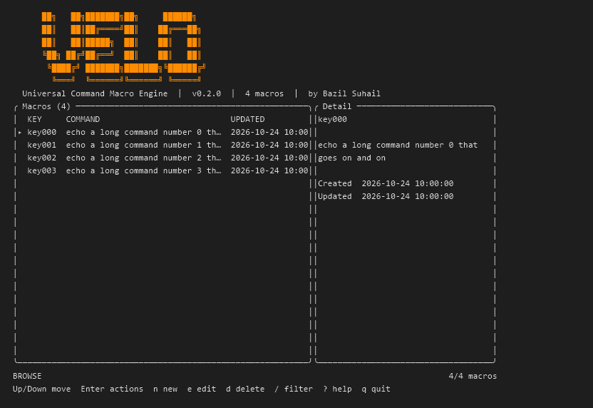

# Velocity

[](https://github.com/BazilSuhail/Velocity/actions)
[](https://github.com/BazilSuhail/Velocity/releases)
[](LICENSE)
[](https://www.rust-lang.org)
[](https://github.com/BazilSuhail/Velocity/releases)

Velocity is a single-binary command-line tool, invoked as `velo`, for storing shell commands as named macros and running them by key. Give a long command a short name once, then run it from any directory, from a script, or from an interactive terminal UI. Macros live in one JSON file on your machine. velo has no daemon, no background service, and no network access.



Install scripts live in `C:\Users\lorde\OneDrive\Documents\git-commit\Velocity\scripts` (`install.ps1` for Windows, `install.sh` for macOS and Linux).

## Installation

Velocity runs on Windows 10 and 11, macOS, and Linux (including WSL). Choose the section for your system. Each path ends with `velo --version` printing a version in a new terminal.

Every route below needs the repository. Get it with git, and update it later with `git pull`:

```text
git clone https://github.com/BazilSuhail/Velocity.git
cd Velocity
```

Prebuilt archives for each release are on the [releases page](https://github.com/BazilSuhail/Velocity/releases). The one-line scripts download those archives, so they work once a release is published. Until v0.2.0 is published, use the build-from-source option.

### Windows

**Option A: one command (no build tools).** Run this in PowerShell:

```powershell
irm https://raw.githubusercontent.com/BazilSuhail/Velocity/main/scripts/install.ps1 | iex
```

The script downloads `velo.exe` into `%USERPROFILE%\.velo\bin` and adds that folder to your user PATH. Open a new terminal afterwards. Pass `-NoPath` to skip the PATH change, or `-Version 0.2.0` to pick a release.

**Option B: build from source with git.**

1. Install git from [git-scm.com](https://git-scm.com/download/win), or run `winget install --id Git.Git -e`.
2. Install Rust from [rustup.rs](https://rustup.rs). Accept the default stable toolchain. When Windows asks for the Visual Studio C++ Build Tools, install them with the "Desktop development with C++" workload. Rust needs that linker on Windows.
3. In PowerShell:

   ```powershell
   git clone https://github.com/BazilSuhail/Velocity.git
   cd Velocity
   cargo install --path .
   ```

   `cargo install` puts `velo.exe` in `%USERPROFILE%\.cargo\bin`. The rustup installer adds that folder to PATH.

4. Open a new terminal and run `velo --version`.

### macOS

**Option A: one command.** The script installs into `~/.velo/bin` and adds that folder to your shell profile:

```bash
curl -fsSL https://raw.githubusercontent.com/BazilSuhail/Velocity/main/scripts/install.sh | bash
```

**Option B: build from source with git.**

```bash
xcode-select --install                      # Apple command line tools, includes git and the C linker
curl --proto '=https' --tlsv1.2 -sSf https://sh.rustup.rs | sh
source "$HOME/.cargo/env"
git clone https://github.com/BazilSuhail/Velocity.git
cd Velocity
cargo install --path .
velo --version
```

### Linux

**Option A: one command.** Works on x86_64 and arm64:

```bash
curl -fsSL https://raw.githubusercontent.com/BazilSuhail/Velocity/main/scripts/install.sh | bash
```

**Option B: build from source with git.** Install the build tools with your package manager, then:

```bash
# Debian or Ubuntu
sudo apt install -y git build-essential curl
# Fedora
sudo dnf install -y git gcc curl

curl --proto '=https' --tlsv1.2 -sSf https://sh.rustup.rs | sh
source "$HOME/.cargo/env"
git clone https://github.com/BazilSuhail/Velocity.git
cd Velocity
cargo install --path .
velo --version
```

### Update and uninstall

- **Update from source:** `git pull`, then `cargo install --path . --force`.
- **Update from the script:** run the installer again.
- **Uninstall:** `cargo uninstall velo`, or delete the install folder (`%USERPROFILE%\.velo` on Windows, `~/.velo` elsewhere) and remove it from PATH.

Your macros stay in the config folder, so uninstalling does not delete them. The location is in [Configuration](docs/configuration.md). Back up `macros.json` first if you want to keep them.

More detail, including PATH setup and troubleshooting, is in [docs/setup.md](docs/setup.md).

## Motivation

Velocity was built by [Bazil Suhail](https://bazilsuhail.netlify.app/) for speed. Every developer retypes the same long commands all day: starting a dev server, running a build, deploying to staging. Velocity removes that friction. You store each command once, then get it back with a few keystrokes.

Speed is the design goal throughout:

- **Fast to start.** A single native binary with no runtime, no interpreter, and no daemon.
- **Fast to use.** Run `velo dev` from any directory, or pick a macro from the terminal UI with the arrow keys.
- **Fast to change.** Edit a command in place without touching a config file.

## Why Velocity

- A long build, deploy, or test command becomes a three-letter key.
- Scripts can call `velo <KEY>` and check the exit code, which is the macro's own code.
- One binary, one JSON file. Back it up by copying it.
- The same commands work on Windows, Linux, macOS, and WSL.

## Features

**Interactive TUI**

- Browse, run, add, edit, delete, and filter macros from the keyboard.
- An actions menu per macro: Run, Update, Delete, Back.
- Filter by key or command text as you type.
- Help overlay (`?`) with the Browse keys and the command forms.
- Running a macro from the TUI suspends the screen, runs the command in the normal console, and waits for Enter before it returns.
- The screen redraws only when state changes.

**Command line**

- `velo <KEY>` and `velo run <KEY>` run a macro and exit with its exit code.
- `velo add`, `velo update`, `velo delete`, `velo list` manage macros.
- `velo` with no arguments opens the TUI in a terminal, and prints the list when output is piped.
- Prompts for missing arguments in a terminal. Scripts get a usage error instead of a hang.

**Storage and safety**

- All macros live in `macros.json`. The location is per platform, and `VELO_HOME` overrides it.
- Writes are atomic: velo writes a temporary file, then renames it over the original.
- A corrupt `macros.json` is never overwritten. velo reports the path and refuses to write until you fix it.
- Older flat-format files are converted automatically on load.
- Keys are validated: no spaces, no `/ \ " '`, no control characters.
- `delete` asks for confirmation in a terminal. `--yes` skips the prompt.

**Cross-platform**

- Windows, Linux, macOS, and WSL. Windows Terminal and PowerShell are the recommended hosts on Windows.
- Macros run through `cmd /C` on Windows and `sh -c` on Linux and macOS.
- Release builds for Linux x86_64 and aarch64, macOS x86_64 and aarch64, and Windows x86_64. Available once a release is published.

**Scripting**

- Exit codes: `0` success, the macro's code when running, `1` for errors, `2` for usage errors, `127` when the macro's shell cannot start.
- Non-interactive mode: output is plain when piped, and nothing prompts.
- `velo delete <KEY> --yes` for scripts.

**Customization through environment variables**

- `VELO_HOME` chooses the directory for `macros.json`.
- `VELO_ASCII` forces ASCII glyphs.
- `NO_COLOR`, `TERM=dumb`, and `CLICOLOR_FORCE=1` control color.
- `COLORTERM=truecolor` selects the 24-bit palette.

See [Configuration](docs/configuration.md#environment-variables) for the full list.

## UI tour

The TUI adapts to the terminal size. The banner shows at 60 or more columns and 20 or more rows, and the details pane at 100 or more columns. The screenshot at the top of this page shows the browse view in a 100 by 30 terminal.

What you see:

- **Header.** The banner, then a subtitle with the version and the macro count. Below 60 columns or 20 rows, a one-line title replaces the banner.
- **Macro table.** KEY, COMMAND, and UPDATED. The selected row starts with a `▸` marker (`>` where Unicode is off). Long commands are cut with an ellipsis. UPDATED is hidden below 60 columns.
- **Details pane.** The selected macro's key, full command, and timestamps. Shown at 100 columns and wider.
- **Status line.** The current mode (BROWSE, ACTIONS, FILTER, and so on), the macro count, and any message such as the exit code of the last run.
- **Footer.** The keys that work in the current mode.

### Actions menu

Press `Enter` on a macro to open its actions menu. It is a small bordered box, titled with the macro's key, with four entries: **Run**, **Update**, **Delete**, and **Back**.

- `Up` and `Down` (or `k` and `j`) move the highlight.
- `Enter` runs the highlighted entry.
- `Esc` or `q` closes the menu without doing anything.

**Run** executes the macro in your terminal and returns to the list when you press Enter. **Update** opens the command editor. **Delete** asks for confirmation first. **Back** closes the menu.

### Help overlay

Press `?` in Browse mode to open the help overlay. It is a box over the list that shows two sections: the Browse keys, and the command forms (`velo add <key> <command>`, `velo update`, `velo delete`, `velo list`, and `velo <key>` to run). Press `?` or `Esc` to close it.

## Quick start

Under a minute, on Linux, macOS, or WSL:

```bash
curl -fsSL https://raw.githubusercontent.com/BazilSuhail/Velocity/main/scripts/install.sh | bash
# open a new terminal, then:
velo add hello "echo hello from velo"
velo hello
velo                       # opens the TUI; press q to quit
```

On Windows, in PowerShell:

```powershell
irm https://raw.githubusercontent.com/BazilSuhail/Velocity/main/scripts/install.ps1 | iex
# open a new terminal, then:
velo add hello "echo hello from velo"
velo hello
velo
```

Full install options, building from source, and PATH setup are in [docs/setup.md](docs/setup.md).

## Commands

| Command | What it does |
|---------|--------------|
| `velo` | Open the TUI in a terminal. Prints the list when output is piped. |
| `velo <KEY>` | Run a macro. Same as `velo run <KEY>`. |
| `velo run <KEY>` | Run a macro. Use this for a key that has the same name as a subcommand. |
| `velo add [KEY] [COMMAND]` | Save a new macro. Prompts for missing arguments in a terminal. |
| `velo update [KEY] [COMMAND]` | Change the command of an existing macro. |
| `velo delete [KEY] [-y, --yes]` | Remove a macro. Asks first unless `--yes` is given. |
| `velo list` | Print all macros as a table, sorted by key. |
| `velo --help`, `velo -h` | Show help. |
| `velo --version` | Show the version. |

Full reference, including exit codes and scripting examples: [docs/commands.md](docs/commands.md).

## Keyboard shortcuts

Browse mode, the default in the TUI:

| Key | Action |
|-----|--------|
| `Up` / `Down`, `k` / `j` | Move the selection |
| `PageUp` / `PageDown` | Move 10 rows |
| `Home` / `g`, `End` / `G` | Jump to the first or last macro |
| `Enter` | Open the actions menu |
| `n` | New macro (key, then command) |
| `e` | Edit the selected command |
| `d` | Delete the selected macro (confirms first) |
| `/` | Filter by key or command |
| `?` | Help overlay |
| `q`, `Ctrl+C` | Quit |

All modes are in [docs/keybindings.md](docs/keybindings.md).

## Configuration

velo has no config file. Macros are stored in one file, `macros.json`:

| Platform | Default location |
|----------|------------------|
| Linux and WSL | `~/.config/velo/macros.json` (or `$XDG_CONFIG_HOME/velo`) |
| macOS | `~/Library/Application Support/velo/macros.json` |
| Windows | `%APPDATA%\velo\macros.json` |

Set `VELO_HOME` to a directory to store macros somewhere else, such as a synced folder. The most useful environment variables are `VELO_HOME`, `VELO_ASCII` (force ASCII glyphs), and `NO_COLOR` (turn off color).

Details, the file format, and backup steps are in [docs/configuration.md](docs/configuration.md).

## Guides

| Guide | Read it when you want to |
|-------|--------------------------|
| [Setup](docs/setup.md) | Install velo, build from source, set PATH, configure storage, update, or uninstall |
| [Commands](docs/commands.md) | Look up a command, flag, or exit code |
| [Keybindings](docs/keybindings.md) | Learn the TUI keys for each mode |
| [Configuration](docs/configuration.md) | Find `macros.json`, set `VELO_HOME`, back up or migrate your store |
| [Platforms](docs/platforms.md) | Install and run velo on Windows, macOS, Linux, or WSL, including quoting rules |
| [Troubleshooting](docs/troubleshooting.md) | Fix a corrupt file, a broken terminal, missing colors, or a command not found |
| [Development](docs/development.md) | Understand the architecture, build, lint, and release the project |
| [Contributing](CONTRIBUTING.md) | Report a bug, propose a change, and open a pull request |
| [Documentation index](docs/index.md) | See all guides in one place |
| [Changelog](CHANGELOG.md) | See what changed in each version |

## Setup

Requirements, install options, PATH setup, and first-run steps are in [docs/setup.md](docs/setup.md). Prebuilt binaries need no Rust toolchain. Building from source needs Rust 1.85 or newer, because the crate uses edition 2024.

## Contributing

Bug reports, documentation fixes, and pull requests are welcome. Read [CONTRIBUTING.md](CONTRIBUTING.md) for the development setup, the checks every pull request must pass (`cargo fmt --check` and `cargo clippy --all-targets -- -D warnings`), and the commit style.

## Roadmap

These items are not implemented yet. This list is not a promise of dates.

- **Mouse support.** velo ignores the mouse. Everything is keyboard-driven.
- **Automated tests.** The repository has no test suite yet. Checks are formatting, clippy, and manual runs.
- **Cursor editing in text fields.** Input fields are append-only. Backspace and Ctrl+U are the only edit keys.

## License

velo is released under the [MIT License](LICENSE). The MIT license lets anyone use, copy, modify, merge, publish, distribute, sublicense, and sell the software for any purpose, including commercial use. The only requirement is to keep the copyright notice and the license text in copies of the software.

## Author

velo is written and maintained by [Bazil Suhail](https://bazilsuhail.netlify.app). Source code and issues are at [github.com/BazilSuhail/Velocity](https://github.com/BazilSuhail/Velocity).
